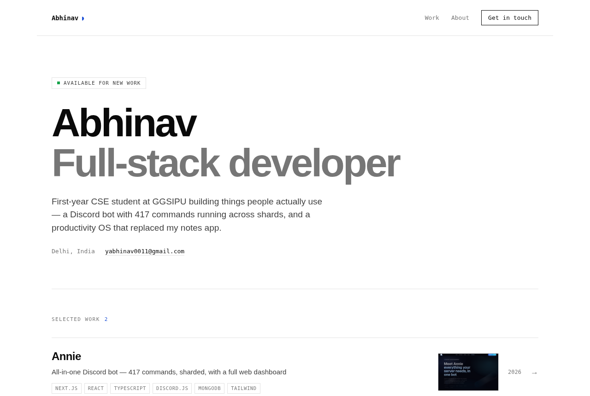
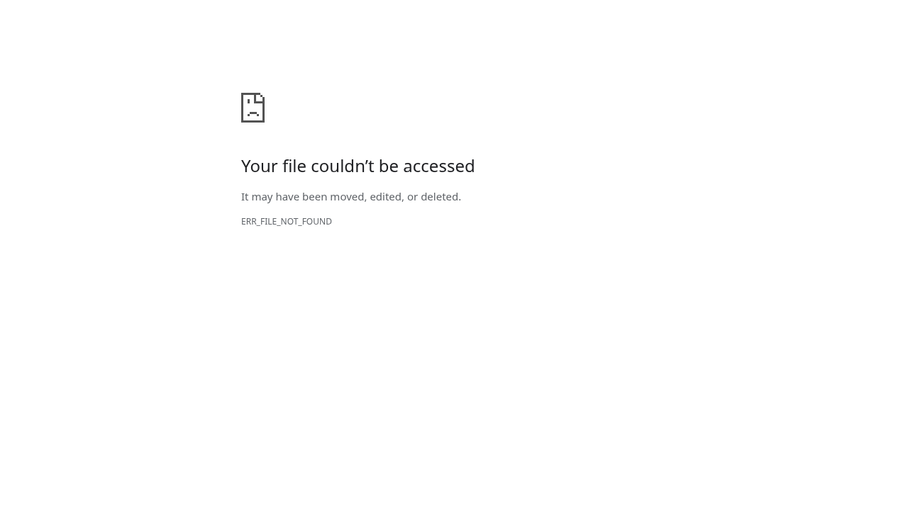

# Portfolio + admin

**A portfolio site you edit from a browser, not a text editor.** Server-rendered
Node, SQLite, and a `/admin` panel for projects, experience, skills and the
contact inbox. No build step, no frontend framework, and two runtime
dependencies in the local path — `express` and `multer`.



<details>
<summary>The admin panel</summary>



</details>


### Why it's built this way

SQLite is Node's own `node:sqlite` — no native module to compile, nothing to
install. Pages are template literals rendered per request, so there is no
bundler, no hydration and no `dist/`. Adding an editable section to the admin is
one entry in the `ENTITIES` object in `server.js` plus a `create table`; the
list view, form, save and delete all come for free.

## Run it

```bash
npm install
cp .env.example .env      # then set ADMIN_PASSWORD in it
npm start
```

- Site: http://localhost:3000
- Admin: http://localhost:3000/admin

| Env var          | Default            | Notes                                              |
|------------------|--------------------|----------------------------------------------------|
| `ADMIN_PASSWORD` | `admin`            | **Set this.** It's the only login.                  |
| `SESSION_SECRET` | random each boot   | Set it in production or logins drop on restart.     |
| `TURSO_DATABASE_URL` | unset          | Set it and the DB moves to Turso. Unset = local file. |
| `TURSO_AUTH_TOKEN` | unset            | Paired with the above.                              |
| `BLOB_READ_WRITE_TOKEN` | unset       | Uploads go to Vercel Blob. `BLOB_STORE_ID` (set by an OIDC-connected store) or `VERCEL` also trigger it. |
| `PORT`           | `3000`             |                                                     |
| `SITE_URL`       | `http://localhost` | Absolute origin. Used by the sitemap and link previews. |
| `DATA_DIR`       | project folder     | Where `portfolio.db` and `uploads/` live. Set to the volume mount in production. |

## What the admin does

- **Projects** — title, summary, full description, cover image, tags, live/repo
  links, year, featured flag, draft/published, sort order. Slugs auto-generate
  from the title and de-duplicate.
- **Experience** and **Skills** — same CRUD, driven by one shared form renderer.
- **Inbox** — contact-form submissions, mark read / delete.
- **Settings** — name, role, tagline, about, photo, social links, résumé URL,
  accent colour, availability badge, SEO title/description, link-preview image.
- **Image upload** — drops files in `uploads/`, served from `/uploads`. Images
  only, 8 MB cap. You can also paste any external URL instead.

Descriptions take a small markdown, escaped before any rule runs so content can
never inject HTML:

| Write | Get |
|---|---|
| blank line | new paragraph (a single newline is a line break) |
| `**bold**`, `*italic*`, `` `code` `` | inline marks |
| `[text](url)` | link; external links open in a new tab |
| `## Heading`, `### Sub-heading` | section headings inside a case study |
| `- item` / `1. item` lines | bulleted / numbered list |
| `` on its own line | full-width figure with the caption under it |
| ```` ``` ```` fences | code block |

## Files

```
server.js        routes, auth, headers, rate limits, schema, entity specs
lib.js           escape / markdown / slugify
notify.js        Discord webhook + Resend email for new messages and replies
views/site.js    public pages (and the two inline scripts the CSP allows)
views/admin.js   admin pages
public/*.css     two stylesheets
public/fonts/    Inter and JetBrains Mono, self-hosted latin subsets
test/            node:test suite: `npm test`
push-content.js  one-shot copy of local content into Turso
portfolio.db     created on first run (gitignored)
uploads/         uploaded images (gitignored)
Dockerfile       production image
fly.toml         Fly.io config, volume mounted at /data
```

## Security

- **Headers.** Every response carries a Content-Security-Policy, `X-Content-Type-Options`,
  `Referrer-Policy`, `X-Frame-Options`, `Permissions-Policy` and (over HTTPS) HSTS. Public
  pages allow only their two inline scripts, by hash; the admin keeps `'unsafe-inline'`
  for its confirm dialogs but sits behind the login. Images may load from any `https:`
  URL because the admin accepts pasted image links.
- **Rate limits** live in a `hits` table, not in memory, so they hold on serverless
  where every request may be a fresh process. Login: 10 attempts per address per 15
  minutes. Contact form: 5 messages per address per hour, plus a honeypot field.
- **Fonts** are served from `public/fonts/`, so a visit makes no third-party request.
- **Login** is a signed, HttpOnly, SameSite cookie compared in constant time. There is
  no session store to leak.

## Tests

```bash
npm test
```

`test/lib.test.js` covers escaping, markdown and slugs. `test/app.test.js` boots the app
against a throwaway database and checks headers, CSP hashes against the shipped scripts,
auth, rate limits, the contact form and a project round-trip through the admin.

Adding a new editable section = one entry in `ENTITIES` in `server.js` plus a
`create table`. The list page, form, save, and delete all come for free.

## Deploying

Storage is switched by environment variable, so the same code runs both ways:

| | Database | Uploads |
|---|---|---|
| **Local** (no env vars) | `portfolio.db` via a libSQL `file:` URL | `uploads/` on disk |
| **Production** | Turso (`TURSO_DATABASE_URL`) | Vercel Blob (`BLOB_READ_WRITE_TOKEN`) |

libSQL *is* SQLite, so the schema and every query are identical in both — only the
driver and the connection string change.

### Vercel + Turso

```bash
# 1. database
turso db create portfolio
turso db show portfolio --url          # -> TURSO_DATABASE_URL
turso db tokens create portfolio       # -> TURSO_AUTH_TOKEN

# 2. set them on the project (plus a password and secret)
vercel env add TURSO_DATABASE_URL production
vercel env add TURSO_AUTH_TOKEN production
vercel env add ADMIN_PASSWORD production
vercel env add SESSION_SECRET production      # openssl rand -hex 32
vercel env add SITE_URL production            # https://your-domain

# 3. create a Blob store in the Vercel dashboard (Storage -> Blob) and connect it.
#    Nothing to copy: a token-based link sets BLOB_READ_WRITE_TOKEN, an OIDC link
#    sets BLOB_STORE_ID. Either one switches uploads over to Blob.

# 4. push your local content up, then deploy
TURSO_DATABASE_URL=... TURSO_AUTH_TOKEN=... node push-content.js
vercel --prod
```

`SESSION_SECRET` must be set in production — without it a new random secret is
generated per cold start and every admin login is immediately invalidated.

### Anywhere with a disk (Fly.io, Railway, a VPS)

`Dockerfile` and `fly.toml` are included and need no Turso or Blob at all — set
`DATA_DIR` to a mounted volume and it uses plain SQLite plus local uploads:

```bash
fly launch --no-deploy
fly volumes create data --size 1
fly secrets set ADMIN_PASSWORD='...' SESSION_SECRET="$(openssl rand -hex 32)"
fly deploy
```

The `Secure` cookie flag is added automatically when the request arrives over HTTPS
(`app.set('trust proxy', 1)` also makes the contact-form rate limiter read the real
client IP rather than the proxy's).

Back up `portfolio.db` and `uploads/` together; they're the whole site.

## Live stats

Project text can embed `{{servers}}`, `{{users}}`, `{{users_k}}` and `{{ping}}`.
They are filled at render from `annie.monster/api/status`, cached in the settings
table and refreshed in the background once the stored copy is older than six
hours, so no page load waits on the network. On Vercel the refresh is handed to
the runtime's `waitUntil`, so it finishes after the response instead of being
killed with the function. If the API is unreachable the last
known values are used and the refresh backs off until the next window.

## Known limits

- Markdown covers the table above, not CommonMark. No tables, no nested lists, no raw HTML.
- One admin user, password in an env var.
- If uploads move to Blob, any setting still pointing at a local `/uploads/...` path is
  ignored rather than served broken; re-upload those images from the admin.
